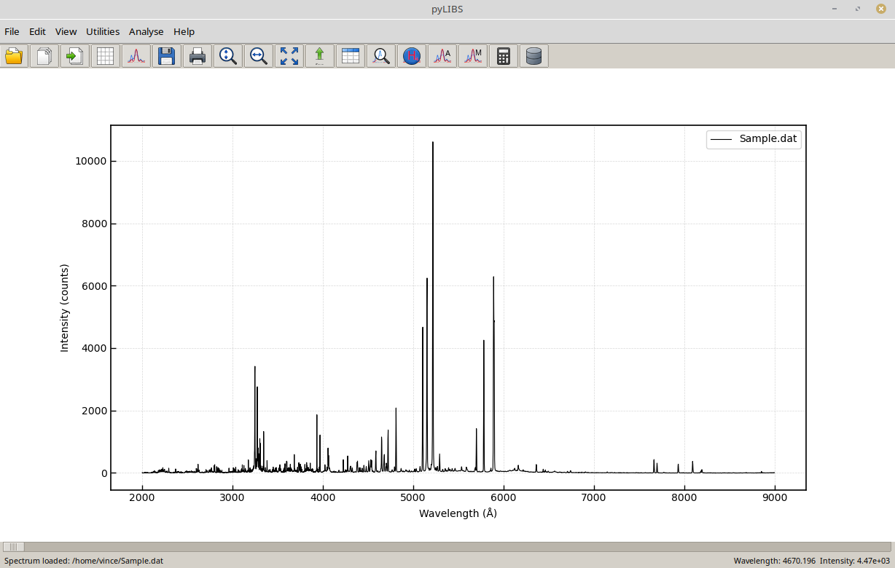

## pyLIBS

Python software for visualization, spectral processing, plasma diagnostics and quantitative analysis of Laser-Induced Breakdown Spectroscopy (LIBS) data.

pyLIBS is a source-available scientific software package for the visualization, processing, interpretation, and quantitative analysis of Laser-Induced Breakdown Spectroscopy (LIBS) spectra.

The software has been developed to provide researchers, students, and laboratory users with a modern and intuitive environment for LIBS data analysis while preserving compatibility with historical databases and workflows established over many years of research.

## Screenshot

## Current Status

pyLIBS is under active development.

The current public release already includes the core functionality required for:

- spectrum visualization
- spectral fitting
- plasma diagnostics
- quantitative analysis

Additional functionality and documentation will be added in future releases.

## Main Features
- Spectrum Visualization
- Interactive visualization of single and multiple LIBS spectra
- Zoom and pan tools
- Linear and logarithmic axes
- Configurable background color
- Grid display
- Trace line visualization
- Spectrum comparison
- Per-window instrumental-response library with automatic range/name matching
- Persistent per-window wavelength calibration with Voigt-refined NIST anchors
- Optional global instrumental FWHM for theoretical-spectrum synthesis and Palleschi H-alpha width correction
- Multi-column dark subtraction, constant dark and external dark trace
- Spectral Line Identification
- Automatic line identification
- Manual line assignment
- Interactive template management
- Incremental template updating
- Support for historical LIBS line databases
- Selectable offline LIBS++ historical or NIST ASD 5.12 SQLite library
- Spectral Fitting
- Single and multiple peak fitting
- Voigt profile fitting
- Automatic and manual fitting modes
- Direct peak selection from the graph; importing a line list is optional
- Batch fitting of multiple spectra
- Export of fitting results to Microsoft Excel
- Plasma Diagnostics
- Saha–Boltzmann analysis
- Calibration-Free LIBS (CF-LIBS)
- Self-absorption correction tools
- Stark broadening analysis
- Hybrid self-absorption chain: Palleschi/Stark plus iterative Yang et al. IRSAC
- Electron density estimation
- Plasma temperature evaluation
- Data Management
- Persistent user preferences
- Automatic restoration of window positions
- Import and export of templates
- Excel report generation

## Scientific Scope

pyLIBS is intended for applications including, but not limited to:

- elemental analysis
- quantitative LIBS
- plasma diagnostics
- calibration-free LIBS
- laboratory spectroscopy
- field-portable LIBS
- cultural heritage
- archaeometry
- environmental monitoring
- industrial process control
- teaching and research

## Installation

Clone the repository:

git clone <repository-url>
cd pyLIBS

Install the required Python packages:

pip install -r requirements.txt
Running pyLIBS

Start the program with:

python pyLIBS.py

## Requirements

- Python 3.11 or later
- NumPy
- SciPy
- Matplotlib
- OpenPyXL

Tested on

- Linux
- Windows
- macOS

## Required Data Files

pyLIBS uses several scientific databases required for spectral identification and plasma diagnostics.

The repository includes the databases required for the public release.

`LIBS.db` preserves the historical LIBS++ library. `LIBS_NIST_5_12.db` is a
separate offline library generated from NIST ASD 5.12 (release 7 November
2024). Select the active library in Edit > Options > Atomic library. The
program records the selected library and response files in CF-LIBS reports.

Instrument response files remain external two-column ASCII/OPC files. Load
all window-specific curves together from Utilities > Instrument response.
pyLIBS matches each curve to its spectral window before windows are joined,
divides intensity by the response, removes unreliable response edges and uses
a linear crossfade where corrected windows overlap. The response curve changes
spectral amplitude but does not determine instrumental line broadening. A single
optional global instrumental Gaussian FWHM can be measured once near H-alpha
(656 nm) and applied unchanged to every spectral window and theoretical line.
This is an explicit constant-FWHM-in-wavelength approximation; it does
not require one calibration line in every window. The value must represent the
instrument-only contribution, not the total LIBS H-alpha width dominated by
Stark broadening. Set it to zero when unknown: pyLIBS then performs no
instrumental-width deconvolution and does not synthesize a misleading
theoretical line profile.

Wavelength calibration is independent of instrumental-response correction.
Open Utilities > Wavelength Calibration, import or select the NIST wavelengths
that are expected in the sample, and estimate each detector window separately.
The program searches for measured local maxima, refines their centers with a
Voigt profile when SciPy is available, and reports the anchors and residuals.
Automatic mode uses a one-line or two-line offset; it accepts a linear
`lambda_corrected = a + b * lambda_raw` scale only with at least three coherent
anchors spanning 5 nm. Suspect anchors can be excluded before applying. Apply
and remember stores the profiles by raw window range, disables the legacy global
shift, and applies the appropriate profile automatically to later spectra in a
measurement series.

Auto Fit does not require a template file. Open Analyse > Auto Fit, find peaks
in the visible interval or add them directly from the graph, review the marked
positions, and run the Voigt fit. Internally pyLIBS still stores these positions
as `TemplateLine` records for compatibility with the original Palleschi engine;
the optional import command is only for reusing a saved analytical-line list.

The H-alpha window exposes only Palleschi's original Lorentzian workflow. The
primary Lorentzian FWHM is corrected with the configured instrumental width and
then used in the Stark electron-density relation. The Gaussian line-fit option
remains available separately under `Analyse > Gaussian / Voigt Fit`; it is not
used to calculate electron density.

Boltzmann, Saha-Boltzmann, CF-LIBS, OPC and theoretical-spectrum synthesis use
one radiometric convention throughout. The response-corrected Voigt area is
treated as radiant energy and converted to the equivalent photon intensity:

`y = ln[5.0341166e15 * Icorr * lambda_nm / abs(Aki * gk)]`

Here `lambda_nm` is always in nm and `Aki` remains in s^-1. The constant is
`1e-9/(h*c)`. IRSAC multiplies `Icorr` before the logarithm. When the common
temperature is fixed, all other elements use slope `-1/kT` and only their
intercepts are refitted. The instrumental-response files must therefore be
defined so division produces an energy-proportional spectrum; a response
defined directly in photon units would require a different ordinate.

The implemented analysis order is: select the signal column, subtract the dark
trace pixel by pixel, divide each window by its own instrumental response,
apply the saved wavelength calibration to each window, join overlapping
windows, fit single or multiple Voigt profiles, calculate electron density from
H-alpha, and apply either Palleschi's Stark correction or the internal-reference
IRSAC equations of Yang et al. (Applied Spectroscopy 72, 129-140, DOI
`10.1177/0003702817734293`). The selective IRSAC branch keeps the fitted Voigt
areas fixed and iterates factors, independent evidence and the temperature of
the chosen thermometric species until the selected lines, temperature and
factors are all stable. Before common-slope quantitation it rejects corrections
whose independently fitted species slope is incompatible with that temperature.
Saha-Boltzmann and CF-LIBS use only the accepted factors. The theoretical-spectrum window is
deliberately downstream and
diagnostic only: it remains locked until an IRSAC-capable correction has been
calculated, converged and applied. Its temperature is read-only, records that
provenance, cannot alter IRSAC or CF-LIBS results, and applies the instrumental
response forward only when comparison in detector counts is requested.

User-specific configuration is intentionally not distributed.

At the first execution, pyLIBS automatically creates a local configuration file based on the supplied example configuration.

## Documentation

The repository currently includes:

- Project documentation
- License information
- Citation information

A comprehensive user manual is under preparation and will be expanded in future releases.

## Citation

If pyLIBS contributes to results published in scientific journals, conference proceedings, theses, dissertations, or other scholarly works, please cite the software using the information provided in CITATION.cff.

Citation information will also be available directly from the GitHub repository.

## License

pyLIBS is distributed under the pyLIBS Academic Non-Commercial License (ANCL) v1.0.

The software may be freely used for research, education, and other non-commercial purposes.

Commercial use requires prior written permission from the copyright holder.

See the LICENSE file for the complete license terms.

## Contributing

External contributions are welcome.

Please open an Issue before proposing major changes.

Please use the GitHub Issues page to report problems or propose improvements.

## History

pyLIBS represents the continuation and modernization of the historical LIBS++ software, preserving many years of development experience while providing a modern Python-based implementation.

## Author

Vincenzo Palleschi

Institute of Chemistry of Organometallic Compounds (ICCOM)
National Research Council (CNR)
Pisa, Italy

Developer and maintainer of pyLIBS
